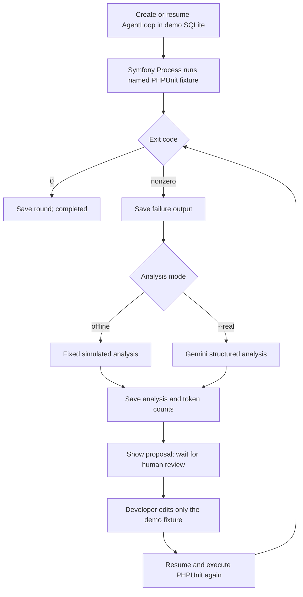

# RentFlow

> Multi-Tenant Rental SaaS Platform built with Laravel 12

[繁體中文](README.md) | [English](README.en.md)

## Laravel Autonomous AI Code Repair Agent Demo

This is an executable engineering demonstration added inside the existing Laravel 12 repository. It is not a separate Laravel project. The demo presents a controlled test-failure analysis and repair-proposal workflow, separate from RentFlow's original queued AI Agent. The original rental system and its Agent documentation remain below.

The demo provides a reproducible PHPUnit case, bounded iterations, persistent status and per-round history, offline simulation, optional Gemini analysis, and human review of repair proposals. It does not apply fixes automatically.

## AI Agent Demo features

- A 10% discount case: subtotal 100, discount rate 10%, expected total 90. The intentionally defective implementation returns the original subtotal, 100.
- Symfony Process runs the named PHPUnit fixture in a child process. Before execution, the process checks Laravel's effective configuration and refuses to run unless it is `sqlite` with database `:memory:`.
- Loop state and per-round history are stored in the separate `database/agent-demo.sqlite`: the existing `agent_loops` table stores task state, while `agent_loop_demo_runs` stores each round's test output, analysis source, status, and token counts.
- Offline mode uses fixed demonstration analysis, reports zero tokens, and makes no network requests. Gemini is called only when `--real` is supplied.
- Analysis produces a repair proposal. A developer reviews and edits the fixture manually, then resumes the run for verification.
- Terminal outcomes include passing tests, the iteration limit, and simulated quota exhaustion.

## Demo Agent Loop architecture



Each command invocation runs one iteration. State usually follows `pending → processing → pending (awaiting human review) → completed`, or ends as `failed` or `waiting_quota`. If the test still fails at the configured limit, the terminal state is `failed / Max loops exceeded`.

## Demo requirements and setup

- PHP 8.2+, installed Composer dependencies, and the `pdo_sqlite` extension.
- Clone this repository and run `composer install`. Run `php artisan key:generate` if required by the application environment. The demo uses a dedicated SQLite file and does not migrate the default database configured in `.env`.
- Offline mode requires no rental database, seed data, queue worker, or API key.

The command's actual options are: `--max-loops=2` sets the default limit for a new loop, `--case=repair|quota` selects the repair example or simulated offline quota exhaustion, `--resume=ID` resumes an existing demo loop, and `--real` explicitly enables Gemini. `--resume=ID --real` can be combined; a resumed run uses the iteration limit already stored in the database. `--case=quota` simulates quota exhaustion only in offline mode.

For real analysis, set the following variables in your local `.env` (never commit the API key):

```dotenv
GEMINI_API_KEY=your_key_here
GEMINI_MODEL=gemini-3.5-flash-lite
GEMINI_DAILY_QUOTA=1000
```

The application reads the key from `GEMINI_API_KEY`. Do not put the key in a command line or source control.

## Offline demo: complete reproducible flow

Start with the deliberately failing test:

```bash
php artisan ai:demo
```

The command prints the Agent Loop ID, iteration, actual PHPUnit failure output, fixed **simulated analysis**, a one-line repair proposal, zero simulated tokens, and a resume command. This mode sends no HTTP request and edits no files.

Review the proposal and manually edit only `tests/Fixtures/AgentDemo/RepairExampleTest.php`, changing:

```php
$total = $subtotal; // Intentional defect: the discount is not applied.
```

to:

```php
$total = (int) ($subtotal * (1 - $discountRate));
```

Resume using the ID printed by the first command:

```bash
php artisan ai:demo --resume=ID
```

The second PHPUnit execution should pass and the loop should end as `completed`. Restore the fixture's intentional failing code before starting another fresh demonstration. To show the iteration limit without calling Gemini, leave the fixture failing and run `php artisan ai:demo --max-loops=1`; the terminal state is `failed`, with reason `Max loops exceeded`.

The terminal output includes the following lines (the numeric ID is generated at runtime):

```text
Agent Loop #<id> | iteration 1/2 | mode: OFFLINE SIMULATION
PHPUnit: FAIL (exit 1)
Failed asserting that 100 is identical to 90.
Offline simulated analysis (not Gemini):
Fix status: proposed; not applied. Human review required.
Next iteration: paused until a human reviews and applies the suggestion.
Token usage: 0 (offline simulation: 0)
```

After a human reviews and applies the fixture-only change, resuming prints:

```text
Agent Loop #<id> | iteration 2/2 | mode: OFFLINE SIMULATION
PHPUnit: PASS
Final status: completed — Tests passed successfully
Token usage: 0 (demo database)
```

If the fixture still fails with `--max-loops=1`, the command prints `Final status: failed | Max loops exceeded` after failure analysis.

To demonstrate quota handling without sending an API request, run `php artisan ai:demo --case=quota`. The output explicitly identifies quota exhaustion as simulated.

## Real Gemini mode

Set `GEMINI_API_KEY` in the local environment and explicitly select real mode:

```bash
php artisan ai:demo --real
```

This mode sends the named fixture's PHPUnit output to Gemini and may consume API quota. The model name comes from `GEMINI_MODEL` (default `gemini-3.5-flash-lite` in `config/services.php`). The local daily quota threshold is set by `GEMINI_DAILY_QUOTA` (default 1000 requests); Gemini may also return rate-limit or quota errors. Supply the API key through the `GEMINI_API_KEY` environment variable. Resume the same run with `php artisan ai:demo --resume=ID --real`. Gemini is not called without `--real`, even if an API key is present. If analysis fails with a quota reason or HTTP 429, the state is saved as `waiting_quota`; the command does not retry automatically. Network, authentication, request-format, and server errors may also cause analysis to fail.

## Results and token records

Loop records and per-round history are stored in the isolated `database/agent-demo.sqlite`, not in the application's configured development database. Each round stores the exit code, complete process output, analysis and its source label, status, and reported token counts. Offline analysis is labelled `offline simulation` and always reports zero tokens. Real-mode token counts come from Gemini's response; the value may be zero if the provider omits usage metadata. This file contains local demo state and may be deleted manually when no longer needed.

## Isolation and current limitations

- The demo state database is the dedicated file `database/agent-demo.sqlite`. Before creating model records, the command switches Laravel's default connection to `agent_demo` and runs only the migrations needed for AI usage, Agent Loop fields, and per-round demo records on that connection. The `agent_loop_demo_runs.agent_loop_id` foreign key references `agent_loops.id`.
- `App\Support\AiAgentTestProcess` gives the child process the environment variables `APP_ENV=testing`, `DB_CONNECTION=sqlite`, and `DB_DATABASE=:memory:`. It first starts Laravel for a database-configuration preflight; if the effective connection is not SQLite `:memory:`, it throws an exception and refuses to create the PHPUnit process. The PHPUnit child uses the same environment variables and runs the standalone fixture with `--no-configuration`.
- The demo SQLite file stores tasks and per-round results across command invocations; the test child's SQLite `:memory:` database isolates that test run. They serve different purposes. The command explicitly directs Agent Loop records and demo migrations to `agent_demo`; it does not migrate, wipe, or refresh the application's configured default database. These are implemented connection choices and a preflight check, not an absolute guarantee against every external environment misconfiguration or host failure.
- Files are not modified automatically. The displayed patch is a proposal; a person reviews it and decides whether to edit the demo fixture.
- Each command invocation runs one iteration; human confirmation separates iterations.
- Default offline analysis is fixed demo data, not AI inference. Real analysis only runs with explicit `--real`.
- This demo makes no claims of general-purpose autonomous code repair, patch correctness, benchmark pass rates, token savings, or performance.

## Original RentFlow system documentation

The following sections retain the original RentFlow rental-management system features, architecture, APIs, data model, installation, and verification documentation, separate from the new demo.

---
RentFlow is a multi-tenant SaaS platform primarily for **B2B rental operators**. It currently implements a core rental operations system, including:

- Multi-tenant isolation architecture
- Vehicle inventory and reservation management
- Flexible pricing and holiday surcharges
- Cross-branch pickup and return workflows
- Member and guest reservation APIs
- A Filament 5 merchant administration panel

---

## 1. Project Overview

RentFlow is an engineering demonstration based on real-world rental operations. It focuses on multi-tenant isolation, concurrent reservation control, pricing consistency, and reliable state transitions.

### Core business value

- **Launch a rental business without a technical team:** each tenant (rental company) independently manages its vehicles, customers, and branches.
- **Automated inventory management:** vehicle location tracking, maintenance periods, and automatic inventory reservation.
- **Flexible pricing:** different weekday, weekend, and special-holiday prices, with automatic rental-period and total calculations.
- **Complete lifecycle tracking:** reservation → confirmation → pickup → return → completion, with strict transition rules for every state.
- **Member experience:** customers can register on the frontend and manage their reservation history.

---

## 2. Engineering Highlights

### Multi-Tenant Isolation

- **Resolution strategy:** public APIs resolve tenants from `{tenantSlug}` in the URL; Filament administration and member APIs resolve them from the authenticated user's tenant relationship. `ResolvePublicTenant` middleware places tenant context in `TenantContext`.
- **Data isolation:** all business tables (vehicles, customers, reservations, orders, and branches) include `tenant_id`. The application enforces same-tenant access through repositories and policies, isolating resources across tenants.
- **Tenant validation:** business logic verifies that externally supplied Vehicle, Branch, and Customer IDs belong to the same tenant, preventing unauthorized access.
- **Customer deduplication:** customer records are bound to their tenant. Customer data is fully isolated across tenants; even the same email creates separate records.

### Reservation Correctness

- **Half-open intervals:** `[start_at, end_at)` allows one reservation to start when the previous one ends, avoiding wasted gaps.
- **Inventory-blocking states:** `PENDING`, `CONFIRMED`, and `PICKED_UP` lock a vehicle; `RETURNED` and `CANCELLED` release it.
- **Conflict detection:** database query `existing.start_at < new.end_at AND existing.end_at > new.start_at` detects overlapping times.
- **Transactional locking:** reservation creation uses a database transaction and `lockForUpdate()` to exclusively lock the vehicle. On MySQL InnoDB this prevents overselling from concurrent reservations. Locking, conflict checks, and reservation creation happen in the same transaction.
- **Minimum rental duration:** every reservation must be at least four hours; validation is in the Reservation Model.
- **Concurrency guarantee:** transactional and exclusive-lock mechanisms are implemented, but high-concurrency stress testing has not yet been performed in a production-grade MySQL environment.

### Pricing Consistency

- **Pricing priority:** holiday price > weekend price > weekday price, distinguishing tenant-defined holidays from ordinary weekends.
- **Rental-period calculation:** any period shorter than 24 hours is still charged as a full day; `PricingService` rounds the minute count up.
- **Price storage:** reservation creation calculates and stores `rental_days` and `amount`, so later vehicle-price changes do not alter historical reservation amounts. Only the total and duration are stored; a detailed `pricing_snapshot` has not been implemented.
- **Amount precision:** all amounts use `decimal(12,2)` to avoid floating-point errors.

### Branch & Vehicle Location

- **Three location semantics:**
  - `current_branch_id`: the branch where the vehicle is physically located now.
  - `pickup_branch_id`: the reservation's pickup branch.
  - `return_branch_id`: the reservation's return branch.
- **Vehicle location prediction:** the Vehicle model provides `getExpectedBranchIdAt()` to predict a vehicle's branch at a future time from historical reservation return branches. `canBeAtBranchAt()` validates whether it can be at a specified branch at a specified time.
- **Cross-branch support:** the database stores pickup and return branch fields, and the backend implements vehicle-location validation to ensure a vehicle will be at the requested pickup branch at pickup time. The frontend does not yet provide a complete cross-branch selection flow, so a valid branch must currently be specified manually.

### API / Frontend Integration

- **Public reservation flow:** guests can reserve without registering; members can sign in and manage all their reservations.
- **Tenant-resolution middleware:** `ResolvePublicTenant` automatically resolves the tenant from the URL and stores it in `TenantContext`.
- **JWT authentication:** member APIs use `tymon/jwt-auth` for stateless authentication and support login, logout, and token refresh.

---

## 3. Feature Status

| Feature | Status | Evidence |
|---|---|---|
| Multi-Tenant Isolation | ✅ Implemented and verified | TenantContext Middleware, `tenant_id` on all models, policy isolation |
| Vehicle / Branch Management | ✅ Implemented and verified | Vehicle/Branch Models, Filament Resources, API implementation |
| Reservation Core Logic | ✅ Implemented and verified | UseCases, transition validation, time-conflict detection, transactional locking |
| Pricing and Snapshot Mechanism | ✅ Implemented and verified | PricingService, amount calculated and stored at reservation creation |
| Guest / Member Reservation Flow | ✅ Implemented and verified | API routes, separate GuestStore/MemberStore, JWT authentication |
| Order Lifecycle | ✅ Implemented | Order automatically created in the same transaction when a reservation is confirmed; order numbers use `lockForUpdate()` to prevent duplicates |
| Filament Administration | ✅ Implemented | All Resources created, state-action buttons complete, five dashboard widgets implemented |
| OpenAPI Documentation | 🟡 Partially complete | l5-swagger configured, but annotations are still missing for some APIs |
| Automated Test Suite | 🟡 Partially implemented | PHPUnit configured and core business logic has baseline test coverage, but the suite is not yet complete |
| Payment Integration | ❌ Not implemented | Only the Order model exists; no Payment tables or payment flow integration yet |

Status key: ✅ fully implemented; 🟡 partially implemented; ❌ not started.

---

## 3.1 Existing AI Agent: feature overview

RentFlow includes an existing Google Gemini-based automated analysis and repair system. It supports two task modes. This existing queued Agent is distinct from the **AI Agent Demo** above.

### Supported task modes

#### Analysis-only mode

- The user supplies an existing error description or test-failure output.
- **`test_path = NULL`**: PHPUnit is not run automatically.
- The Agent sends the provided content to Gemini for analysis and saves the result.
- It provides possible root causes and repair suggestions, but **does not apply fixes automatically**.
- Analysis completion only means that AI returned a response; it does not mean a fix was completed or tests passed.
- If the analysis is valid but a fix proposal is invalid, the task is still marked complete and the unapplied proposal is recorded.
- If the AI response is invalid or analysis fails, the task is correctly marked failed.

#### Automated repair mode

- A valid `test_path` (test-file path) is required.
- The system runs tests → analyzes failures → generates a fix proposal → validates the fix.
- The default maximum is 3 iterations (adjust with `--max-loops`).
- Validated fixes are automatically applied only when `--auto-apply-fixes` is enabled.
- Termination conditions: tests pass, maximum iterations reached, permanent AI-analysis failure, or test-execution failure.

---

## 4. Technology Stack

| Component | Technology | Version | Description |
|---|---|---|---|
| Language | PHP | 8.2+ | Minimum project requirement |
| Framework | Laravel | 12.x | Main framework |
| Admin Panel | Filament | 5.0 | Administration panel |
| Permission Management | Filament Shield | 4.3 | Filament permission plugin with Spatie Permission |
| Permission Core | Spatie Permission | 6.25 | Role/Permission foundation |
| API Authentication | JWT Auth | 2.3 | Stateless authentication via tymon/jwt-auth |
| API Documentation | L5 Swagger | 11.1 | OpenAPI/Swagger document generation |
| Database | MySQL | - | Primary data store |
| Cache / Queue | Redis | 7-alpine | Cache and queue processing |
| Containerization | Docker + Docker Compose | - | Containerized development environment |
| Frontend Framework | Vue 3 | 3.5.x | Client frontend |
| Test Framework | PHPUnit | 11.5.3 | Unit and feature testing |

---

## 5. System Architecture

RentFlow uses a **Modular Monolith** architecture, with clear code layers and no unnecessary abstraction:

```text
┌─────────────────────────────────────────────────────┐
│                     HTTP Layer                      │
│  Filament Admin / REST API / Middleware             │
├─────────────────────────────────────────────────────┤
│               Application Layer                     │
│  UseCases / DTOs / Events                           │
├─────────────────────────────────────────────────────┤
│                 Domain Layer                        │
│  Models / Enums / Services / Business Rules         │
├─────────────────────────────────────────────────────┤
│              Infrastructure Layer                   │
│  Repositories / Eloquent Implementations            │
└─────────────────────────────────────────────────────┘
                              │
                              ▼
                           MySQL / Redis
```

### Example request flow (create a reservation)

1. The frontend sends a request to the API.
2. `ResolvePublicTenant` middleware resolves the tenant and stores it in TenantContext.
3. The Controller validates input and creates a `CreateReservationData` DTO.
4. The CreateReservation UseCase executes business logic.
5. `DB::transaction()` wraps vehicle locking, conflict checks, and reservation creation.
6. A `ReservationCreated` event is dispatched.
7. The created reservation resource is returned.

---

## 6. Multi-Tenant Isolation Implementation Details

### Tenant resolution strategy

RentFlow uses a **Shared Database / Shared Schema** architecture. All business data is isolated through `tenant_id`. Tenants are resolved in two ways:

1. **Public API:** `ResolvePublicTenant` middleware queries tenants with `is_public = true` using `{tenantSlug}` in the URL path.
2. **Filament administration / member API:** the authenticated user's `tenants()` relationship determines accessible tenants; Super Admin can access all tenants.

### Cross-tenant protection

- Queries for reservations, vehicles, customers, and other resources automatically add `tenant_id = current_tenant_id`.
- Laravel Policies perform a second authorization check to prevent access to another tenant's resources.
- Customer records are bound to tenants. Even if the same person reserves with the same email across tenants, separate customer records are created.

### Seed data

The system seeds three public tenants for development and testing:

- Taipei Rental (`taipei-rental`)
- Taichung Rental (`taichung-rental`)
- Kaohsiung Rental (`kaohsiung-rental`)

---

## 7. Rental Domain Entity Relationships

### Core entity relationships

```text
Tenant (1) ──┬── (N) User
             ├── (N) Vehicle
             ├── (N) VehiclePricing
             ├── (N) Customer
             ├── (N) Holiday
             ├── (N) Branch
             ├── (N) Reservation
             └── (N) Order

Branch (1) ──┬── (N) Vehicle (current_branch_id)
             ├── (N) Reservation (pickup_branch_id)
             └── (N) Reservation (return_branch_id)

Vehicle (1) ── (N) Reservation
Customer (1) ── (N) Reservation
Reservation (1) ── (1) Order
```

### Key fields on main entities

- **Tenant**: `name`, `slug`, `is_public`
- **Vehicle**: `current_branch_id`, `status`, maintenance-period fields
- **Reservation**: `pickup_branch_id`, `return_branch_id`, `start_at`, `end_at`, `status`, `amount`, `rental_days`
- **Order**: automatically generated from a reservation and includes a unique order number

---

## 8. Reservation Correctness Implementation

### Valid state transitions

```text
PENDING
   │
   ├─► CONFIRMED (only from PENDING)
   │      │
   │      ├─► PICKED_UP
   │      │      │
   │      │      └─► RETURNED
   │      │
   │      └─► CANCELLED (only PENDING/CONFIRMED may be cancelled)
   │
   └─► CANCELLED
```

### State descriptions

- `PENDING`: reservation created but not yet confirmed; it still occupies inventory.
- `CONFIRMED`: merchant confirms the reservation and an order is created automatically.
- `PICKED_UP`: customer has picked up the vehicle.
- `RETURNED`: customer returned the vehicle and inventory is released.
- `CANCELLED`: reservation cancelled and inventory released.

### Inventory-blocking states

`BLOCKING_STATUSES = [PENDING, CONFIRMED, PICKED_UP]`; only these states occupy vehicle inventory.

### Time-conflict detection

```php
// Half-open time interval [start_at, end_at)
existing.start_at < new.end_at AND existing.end_at > new.start_at
```

This allows the next reservation to start exactly when the previous reservation ends, without gaps or overlap.

### Transactional locking strategy

All reservation-creation operations run inside a database transaction and exclusively lock the vehicle record:

```php
return DB::transaction(function () use ($data) {
    $vehicle = Vehicle::where('id', $data['vehicle_id'])
        ->where('tenant_id', $data['tenant_id'])
        ->lockForUpdate()
        ->firstOrFail();
    // ... remaining validation and creation
});
```

On MySQL InnoDB, `lockForUpdate()` places an exclusive lock on the row. Combined with the in-transaction conflict check, this prevents overselling from concurrent reservations.

---

## 9. Pricing Rules Implementation

### Pricing priority

1. **Holiday price (`holiday_price`)**: checks the tenant's `holidays` table.
2. **Weekend price (`weekend_price`)**: Saturday and Sunday.
3. **Weekday price (`weekday_price`)**: other working days.

### Rental-period calculation

```php
$diffInMinutes = $startAt->diffInMinutes($endAt);
return (int)ceil($diffInMinutes / (24 * 60));
```

Any period shorter than 24 hours counts as one full day to ensure correct rental charges.

### Price snapshot mechanism

At reservation creation, the total amount is calculated and stored in the Reservation's `amount` and `rental_days` fields. Later changes to vehicle pricing do not affect historical reservation amounts, providing a price snapshot.

---

## 10. Branch & Vehicle Location Semantics

### Three distinct location fields

| Field | Meaning | Used for |
|---|---|---|
| `current_branch_id` | Branch where the vehicle is physically located now | Vehicle's location while idle |
| `pickup_branch_id` | Reservation pickup branch | Pickup location selected by the customer |
| `return_branch_id` | Reservation return branch | Return location selected by the customer |

### Vehicle location prediction

The Vehicle model's `getExpectedBranchIdAt()` method predicts the branch where the vehicle will be at a future time, based on return branches from historical reservations. This provides a basis for cross-branch dispatching.

### Current limitation

The backend fully implements cross-branch pickup/return location validation. `canBeAtBranchAt()` checks whether a vehicle can be at the pickup branch at the specified time. The frontend does not yet provide a dynamic cross-branch selection UI; a qualifying branch must be specified manually.

---

## 11. Authentication & Authorization

### Dual authentication architecture

- **Filament administration:** session authentication (`web` guard), restricted to platform staff.
- **Member API:** stateless JWT authentication (`api` guard) for frontend customers.

### Role and permission architecture

```text
User
  │
  ├─ Super Admin (platform super administrator): access to all tenants and resources
  ├─ Tenant Admin (tenant administrator): manage all resources for their tenant
  └─ Tenant Staff (tenant staff): access authorized resources for their tenant
```

### Authorization flow

Spatie Permission stores role and permission data → Laravel Policy checks the actual operation → Filament Resource/API Controller performs it.

---

## 12. API Reference

### API version and prefix

All APIs are version 1, with prefix `/api/v1/`.

### Public APIs (no authentication required)

```text
GET  /api/v1/public/{tenantSlug}/vehicles                        # List a tenant's public vehicles
GET  /api/v1/public/{tenantSlug}/vehicles/available              # Check vehicle availability
POST /api/v1/public/{tenantSlug}/vehicles/{id}/calculate-price   # Calculate a rental price
GET  /api/v1/public/{tenantSlug}/vehicles/{id}                   # Get one vehicle's details
GET  /api/v1/public/{tenantSlug}/branches                        # List a tenant's branches
POST /api/v1/public/{tenantSlug}/reservations                    # Guest creates a reservation
```

### Member authentication APIs

```text
POST /api/v1/{tenantSlug}/customer/auth/register         # Register a member
POST /api/v1/{tenantSlug}/customer/auth/login            # Member login
POST /api/v1/{tenantSlug}/customer/auth/refresh          # Refresh JWT (JWT authentication required)
POST /api/v1/{tenantSlug}/customer/auth/logout           # Member logout (JWT authentication required)
GET  /api/v1/{tenantSlug}/customer/auth/me               # Get current member profile (JWT authentication required)
POST /api/v1/{tenantSlug}/customer/auth/forgot-password  # Forgot password
POST /api/v1/{tenantSlug}/customer/auth/reset-password   # Reset password
POST /api/v1/{tenantSlug}/customer/profile               # Update profile (JWT authentication required)
```

### Member-only APIs (JWT authentication required)

```text
GET    /api/v1/{tenantSlug}/customer/reservations          # List member reservations
GET    /api/v1/{tenantSlug}/customer/reservations/{id}     # Get one reservation
POST   /api/v1/{tenantSlug}/customer/reservations          # Member creates a reservation
POST   /api/v1/{tenantSlug}/customer/reservations/{id}/cancel # Cancel a reservation
```

### OpenAPI documentation endpoint

`/swagger/api/documentation` (accessible in the development environment)

---

## 13. Frontend & Admin Panel

### Implemented Filament administration features

- **Platform administration:** tenant, user, and role management (visible only to Super Admin).
- **Tenant administration:** vehicle, pricing, customer, branch, and holiday management.
- **Operations:** reservation and order management, with confirm, pickup, return, and cancel actions.
- **Dashboard:** widgets for key metrics, recent reservations, pending actions, and more.

### Completed Vue frontend flows

- Member registration and login
- Browse and search vehicles
- Check availability and calculate rental prices
- Guest and member reservation flows
- Manage member reservation history

---

## 14. Main Database Tables

| Table | Description |
|---|---|
| tenants | Tenant records |
| users | Platform users (administrators) |
| tenant_user | User-to-tenant relationship |
| vehicles | Vehicle master records |
| vehicle_pricing | Vehicle pricing |
| branches | Business branches |
| customers | Rental customers |
| holidays | Tenant-defined holidays |
| reservations | Reservation records |
| orders | Order records (generated from reservations) |
| (no payments table) | Payment features are not implemented |

---

## 15. Testing Strategy

### Test focus areas

- Tenant isolation: verify users cannot access resources across tenants.
- Reservation conflicts: verify that the same vehicle cannot have overlapping reservations.
- State transitions: verify invalid state changes are rejected.
- Pricing calculations: verify holiday, weekend, and weekday prices are applied correctly.
- Time boundaries: verify the half-open interval design works correctly.

### Run tests

```bash
./vendor/bin/phpunit
```

---

## 16. Setup & Development

### Requirements

- Docker + Docker Compose
- PHP 8.2+ for local development (or PHP supplied by Docker)
- Node.js 20+

### Installation

```bash
# Copy the environment template
cp .env.example .env

# Install PHP dependencies
composer install

# Install Node.js dependencies
npm install

# Generate the application key
php artisan key:generate

# Generate the JWT secret
php artisan jwt:secret

# Start Docker containers
docker-compose up -d

# Run database migrations
php artisan migrate

# Seed the default tenants and administrators
php artisan db:seed

# Build frontend assets
npm run dev
```

### Common development commands

```bash
# Regenerate administration assets (when adding a Filament Resource)
php artisan filament:optimize

# Clear the route cache
php artisan route:clear

# Clear the configuration cache
php artisan config:clear

# Clear the event cache
php artisan event:clear
```

---

## 17. Project Structure

```text
rentflow/
├── app/
│   ├── Application/           # Application layer - UseCases, DTOs, Events
│   │   └── Reservations/      # Reservation application logic
│   ├── Filament/              # Filament administration resources
│   │   └── Resources/         # All resources (Tenants/Vehicles/Branches, etc.)
│   ├── Http/                  # HTTP layer - Controllers, Middleware, Requests
│   │   ├── Controllers/       # API and frontend controllers
│   │   └── Middleware/        # Custom middleware (ResolvePublicTenant, etc.)
│   ├── Models/                # Data models - Tenant, Vehicle, Reservation, etc.
│   ├── Policies/              # Laravel Policy authorization logic
│   ├── Services/              # Business services - PricingService, etc.
│   └── Support/               # Shared support classes - TenantContext, etc.
├── database/
│   ├── migrations/            # Database migrations
│   ├── factories/             # Factories
│   └── seeders/               # Seeders
├── routes/
│   └── api.php                # API route definitions
├── resources/
│   └── js/                    # Vue frontend source
├── docker-compose.yml         # Docker Compose configuration
├── Dockerfile                 # PHP container
└── README.md                  # Traditional Chinese documentation
```

---

## 18. Roadmap

### Short-term planned work

- [ ] Complete payment integration (Line Pay, credit cards)
- [ ] Complete OpenAPI annotations for all APIs
- [ ] Write a complete set of PHPUnit tests for core business logic
- [ ] Implement frontend vehicle-location validation for cross-branch pickup and return
- [ ] Add email notifications (reservation confirmation, pickup reminders, etc.)

### Mid-term plans

- [ ] Implement vehicle maintenance scheduling
- [ ] Add insurance options and add-on service pricing
- [ ] Implement member points and tier system
- [ ] Build BI reports and analytics dashboards
- [ ] Support multiple languages in administration and frontend

### Long-term direction

- [ ] Consider splitting high-load services into microservices
- [ ] Adopt Event Sourcing and CQRS
- [ ] Implement multi-region deployment support

---

## 19. Architecture Decisions

Architecture decisions (ADRs) recorded for this project:

- There are no separate ADR documents; decisions are reflected in code and this README.
- Core design principle: solve practical problems first and avoid premature abstraction.
- Preserve correctness of critical operations with a single database transaction; do not rely on Redis as the final consistency boundary.

---

## 19.1 Existing AI Agent Manual Verification Guide

This section documents the original queued RentFlow AI Agent, not the isolated `ai:demo` command above.

### Prerequisites

Ensure the Gemini settings are configured in `.env`:

```env
GEMINI_API_KEY=your_api_key_here
GEMINI_MODEL=gemini-3.5-flash-lite
GEMINI_DAILY_QUOTA=1000
```

### Manual verification

#### 1. Create an analysis-only task

Use `--content` to provide an error description, omit `--test-path` (so `test_path` is `NULL`), and do not enable `--auto-apply-fixes`:

```bash
php artisan ai:agent start --content="Test failure: assume the UserController store method encounters a database error; analyze possible root causes and suggest a fix. This is a description for analysis and has not been verified by an actual test." --max-loops=3
```

#### 2. Confirm the task was created

The command prints output similar to:

```text
Created new agent loop with ID: {YOUR_TASK_ID}
Loop configuration: max_loops=3, auto_apply=false, test_path=none
Job dispatched to queue. Processing will begin shortly.
Check status with: SELECT * FROM agent_loops WHERE id = {YOUR_TASK_ID}
```

#### 3. Run a worker according to the project's queue configuration

Start a Queue Worker based on the configured queue:

```bash
# When using the database connection (common in development)
php artisan queue:work --queue=default --tries=6

# With the sync driver (local development/testing), the job runs immediately
```

#### 4. Inspect the result

Check the `agent_loops` table for changes to:

- `id`: task ID
- `status`: task status (`pending` → `processing` → `completed`/`failed`)
- `ai_analysis`: AI response (JSON)
- `failure_reason`: failure reason, if any
- `termination_reason`: why processing ended, when complete
- `current_loop`: current iteration
- `last_test_exit_code`: PHPUnit exit code (not updated in analysis-only mode)
- `last_test_output`: PHPUnit output (not updated in analysis-only mode)

Example query:

```sql
SELECT id, status, termination_reason, ai_analysis, completed_at
FROM agent_loops
WHERE id = YOUR_TASK_ID;
```

### Complete automated repair flow (CustomerAuth registration transaction)

The `--content` example above is **analysis-only**: without `--test-path`, the Agent does not run PHPUnit; without `--auto-apply-fixes`, it does not apply a patch. To run the complete “test → analyze → validate/apply fix → test again” workflow, follow these steps.

#### 1. Run the Feature Test and establish the current baseline

```bash
php artisan test --filter=CustomerAuthTest
```

`tests/Feature/CustomerAuthTest.php` covers two cases: when `JWTAuth::fromUser()` throws `JWTException`, the API returns HTTP 500 and the User is rolled back; and when registration succeeds, the API returns the existing Token/User fields. If these tests pass, the current code already meets these assertions, so the Agent finishes without calling Gemini or changing files.

#### 2. Create a task with a test path and permission to apply fixes

On a version where the target test actually fails, run:

```bash
php artisan ai:agent start --test-path=tests/Feature/CustomerAuthTest.php --allowed-files=app/Http/Controllers/Api/CustomerAuthController.php --auto-apply-fixes --content="Run tests/Feature/CustomerAuthTest.php. If it fails, use the actual PHPUnit output and current source to fix the transaction consistency in CustomerAuthController::register. User::create() and JWTAuth::fromUser($user) must run in the same DB::transaction() callback; JWTException must leave the callback so the transaction rolls back. Preserve the existing validation rules and API response format, and modify only the Controller in the allowed-files list. Use search_code/replace_code that exactly match the current file, apply a validated fix, then rerun the same test and report its actual result." --max-loops=3
```

This command specifies the test file, enables `--auto-apply-fixes`, and restricts modifications to `CustomerAuthController.php`. The AI proposal must still pass the project's path validation and exact source-replacement requirements before it can be applied.

#### 3. Run the job according to the queue configuration

The command prints the Agent Loop ID and configuration, for example:

```text
Created new agent loop with ID: {YOUR_TASK_ID}
Loop configuration: max_loops=3, auto_apply=true, test_path=tests/Feature/CustomerAuthTest.php
Job dispatched to queue. Processing will begin shortly.
```

For an asynchronous queue, start a worker:

```bash
php artisan queue:work --queue=default --tries=6
```

With `sync` as the default queue, the initial job runs synchronously. However, when a database queue connection is configured, subsequent loop iterations are placed on the database queue and still require a worker. If a test still fails, the Agent analyzes its output; it schedules another test iteration only after a proposal passes validation and is successfully applied.

#### 4. Inspect each test result, analysis, and final status

Use the Loop ID printed by the command:

```sql
SELECT id, status, current_loop, max_loops, test_path,
       last_test_exit_code, last_test_output, ai_analysis,
       modified_files, patch_history, failure_reason,
       termination_reason, completed_at
FROM agent_loops
WHERE id = YOUR_TASK_ID;
```

- `last_test_exit_code` and `last_test_output`: confirm PHPUnit actually ran and inspect its output.
- `ai_analysis`: review the AI analysis; analysis text alone does not mean a patch was applied.
- `modified_files` and `patch_history`: confirm whether files changed and inspect the saved patch history.
- `status`, `current_loop`, and `termination_reason`: determine whether the task completed, failed, or reached its iteration limit.
- `php artisan ai:agent usage`: inspect Gemini usage recorded by the existing Agent.

Inspect the actual diff and rerun the test manually:

```bash
git diff -- app/Http/Controllers/Api/CustomerAuthController.php
php artisan test --filter=CustomerAuthTest
```

Only actual file changes plus a passing post-fix test establish successful automated repair. If the test passes at the start, the task ends with test success and no patch. If the AI proposal has a mismatched path or search snippet, AI/quota processing fails, or the post-fix test still fails, inspect `failure_reason` and `termination_reason`; do not report the repair as successful.

### Verification scenarios

#### Scenario A: analysis succeeds ✅

- Action: create a task with a non-empty error description and no `test_path`.
- Expected result:
  - `status` changes to `completed`.
  - `ai_analysis` contains content.
  - `termination_reason` is `Analysis completed with proposed fixes (unverified, no test_path)` or similar.
  - `last_test_exit_code` remains `NULL` (no test was run).
- ⚠️ This scenario consumes Gemini API quota.

#### Scenario B: no usable fix proposal

- Action: provide an ambiguous error description for which AI cannot generate a repair proposal.
- Expected result:
  - `status` changes to `completed`.
  - `termination_reason` is `Analysis completed with no fixes (text-only input, no test_path)`.
  - AI completed its analysis but could not provide concrete repair steps.

#### Scenario C: invalid fix-proposal path

- Action: provide error content that causes AI to propose a nonexistent file path.
- Expected result:
  - `status` remains `completed` (invalid fixes do not invalidate a successful analysis-only task).
  - `termination_reason` is `Analysis completed with invalid fix proposals (unable to apply fixes)`.
  - The analysis succeeded, but the system cannot validate the proposed path.

#### Scenario D: CustomerAuth PHPUnit automated-repair verification

- Action: use the complete command above with `tests/Feature/CustomerAuthTest.php`, `--auto-apply-fixes`, and `--allowed-files` restricted to the registration Controller.

```bash
php artisan ai:agent start --test-path=tests/Feature/CustomerAuthTest.php --allowed-files=app/Http/Controllers/Api/CustomerAuthController.php --auto-apply-fixes --max-loops=3
```

- To determine whether tests actually ran:
  - `last_test_exit_code` has a value (not `NULL`).
  - `last_test_output` contains PHPUnit output.
  - Manually rerun the same test to compare: `php artisan test --filter=CustomerAuthTest`.
  - After a fix, confirm another test run has exit code 0 and `termination_reason` is `Tests passed successfully`.

### How to interpret verification results

| Verification item | How to check |
|---|---|
| Gemini API call | Check request records and errors in `storage/logs/laravel.log` |
| AI analysis completed | `ai_analysis` is not `NULL` and `status` is `completed` |
| PHPUnit ran | Check `last_test_exit_code` and `last_test_output`; only tasks with `test_path IS NOT NULL` update these fields |
| Fix applied | Check the `modified_files` field or inspect `git status` / `git diff`; do not rely on the proposal alone |
| Fix verified | A post-fix PHPUnit run must exist, with `status = completed` and `termination_reason = Tests passed successfully` |

> ⚠️ Important: analysis-only tasks with `test_path = NULL` never run PHPUnit. Therefore, `last_test_exit_code = 0` does not mean tests passed; it means the field was never updated. Analysis complete, fix applied, and tests passed are distinct outcomes.

---

## 20. License

This project is for educational and demonstration purposes only. The code may not be used in commercial products.
